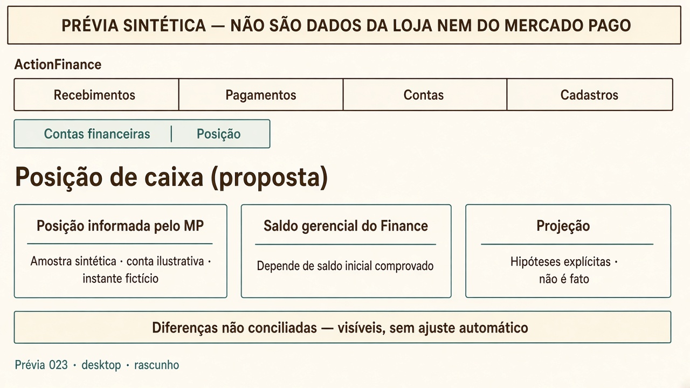
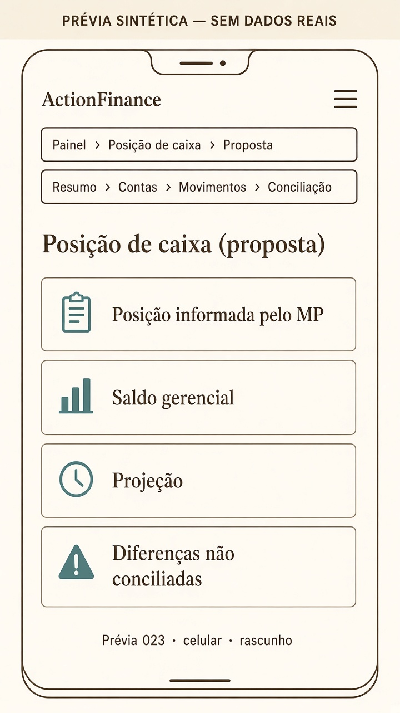

# ACTIONFINANCE_PROJETO_TESOURARIA_MP_023

Identificador: ACTIONFINANCE_PROJETO_TESOURARIA_MP_023. Data: 09/10/2026. Documento independente. Prompt de origem: [ACTIONFINANCE_PROMPT_TESOURARIA_MP_023](../prompts/ACTIONFINANCE_PROMPT_TESOURARIA_MP_023.md). Baseline de requisitos: AF-BL-023 revisão 1.0. Não implementa tesouraria, não importa fatos em produção, não movimenta dinheiro e não altera saldo inicial produtivo.

Este recorte concretiza a primeira etapa financeira do projeto analítico 022. Não substitui 019/020/021. Aceite e implementação das capacidades novas são decisões posteriores sobre este desenho.

| Campo | Valor |
|---|---|
| Autoria da decisão de recorte | Proprietário (09/10/2026) |
| Estado | Projeto executivo — não implementado |
| Produto publicado no momento | `0.1.0` (conferido em `GET /api/v1/system/info`) |
| Schema publicado | última verificação Flyway **V19** em 05/10/2026; **não** reinspecionado neste ciclo |
| V20 local | só no repositório (019); não é tesouraria |

## 0. O que este ciclo autoriza e o que não autoriza

Autoriza: inspeção, contrato proposto, métricas, regras, recorte implementável, prévia sintética.

Não autoriza: pagar pelo Finance; payout; scraping; tratar LIST do Pay como extrato; criar relatório agendado/e-mail no MP; serviços pagos novos; ajuste automático de saldo; obrigação fictícia; classificar despesa só pelo favorecido; IA preditiva.

## 1. Confrontação com o domínio existente

O domínio operacional permanece. Tesouraria não cria um segundo financeiro.

| Peça existente | Serve neste fluxo | Lacuna |
|---|---|---|
| `financial_title` PAYABLE/RECEIVABLE | Compromisso com valor, competência, vencimento, categoria, contraparte | Sem parcelas; um `due_date`; origem só `MANUAL` |
| Lista A pagar / A receber | Jornada de obrigação; resumo «A pagar / Vencidos» **não** é saldo bancário (`App.tsx` declara isso) | Sem conta de pagamento *prevista*; sem vínculo Panne |
| `settlement` + alocação 1:1 | Baixa gerencial de pagamento já realizado | UNIQUE um título por baixa; origem só `MANUAL`; sem vínculo a linha de extrato |
| `settlement_reversal` | Desfaz efeito da baixa no controle | Não é devolução MP |
| `financial_account` BANK/CASH/OTHER | Conta gerencial local; tipo BANK cabe a «conta MP» | Sem collector/user; saldo = soma de `cash_movement`; sem extrato |
| `cash_movement` OPENING/SETTLEMENT/REVERSAL | Saldo gerencial | Não é extrato MP; Loja publicada: sem títulos, logo sem movimentos operacionais |
| `pay_receipt_transaction` | Observação de **cobrança** Hub/Pay | Não é movimento de conta; sem tarifa/líquido/disponibilidade |
| `pay_company_mapping` | Empresa AF → `pay_app_id` (ex. `lojadepaes`) | Não identifica conta MP nem collector |
| `OriginKind.FILE` | Cadastro de contraparte | Baixa/título **não** aceitam FILE |
| Conciliação (`statement_*`) | Prevista em DAT_001 FUTURE | **Inexistente** |

Preservar: máquina de estados do título; ausência ≠ zero; sem DELETE de fatos; autorização por empresa; Pay não liquida título.

Evoluções explícitas (só após aceite): origem FILE/SYSTEM em título/baixa; alocação N títulos ↔ 1 movimento; linhas de extrato; vínculo conta AF ↔ identidade MP; conta prevista no título sem gerar baixa.

## 2. Identidades — não fundir

| Identidade | O que é | O que não é |
|---|---|---|
| Empresa AF | Pessoa jurídica administrada (`company_id`) | App Hub, collector, conta MP |
| Aplicação Hub | `pay_app_id` / `lojadepaes` | Conta financeira |
| ActionHub Pay | Sistema de cobrança; LIST/LOOKUP via Spider | Extrato; executor de contas a pagar nesta etapa |
| Conta MP | Carteira/saldo do titular no processador | Pedido Hub |
| `collector_id` / user MP | Titular na API MP | **Não persistido no AF**; não conferido neste ciclo |
| Conta financeira AF | Registro gerencial local | Autenticação bancária |

Se a mesma conta MP servir Loja e outras apps, ou misturar pessoal e empresarial, o saldo informado **não** se atribui automaticamente à Loja. Perímetro só depois de amostra autorizada que mostre titularidade e filtro possível (referência externa, app, descrição). Sem essa prova, a posição MP permanece «conta do titular», não «caixa da Loja».

## 3. Três bases — nunca o mesmo «saldo disponível»

| Base | Definição | Fonte | Pode faltar |
|---|---|---|---|
| **P-MP** Posição informada pelo MP | Disponível / a liberar / bloqueado **conforme a fonte escolhida**, com conta, moeda e instante | Relatório ou consulta oficial da conta | Sem amostra: **não apresentar número** |
| **P-AF** Saldo gerencial | OPENING comprovado + movimentos SETTLEMENT/REVERSAL válidos da conta | `cash_movement` | Sem OPENING comprovado: **não afirmar** P-AF; não inventar zero |
| **P-PRJ** Projeção | Saldo-base **declarado** + entradas futuras elegíveis − saídas futuras elegíveis | Hipótese + títulos em aberto | Sem saldo-base escolhido: só agenda de compromissos |

Diferença visível: `P-MP − P-AF` (mesmo recorte de conta/moeda/data). Sem extrato **ou** sem OPENING: estado «conciliação incompleta»; proibido ajuste para fechar.

Aprovação de cobrança ≠ disponibilidade. LIST Pay ≠ P-MP.

## 4. Mapa de fontes

```text
Pedido Loja/Hub ──► orders (cobrança) ──► LIST_PAYMENT / LOOKUP ──► pay_receipt_transaction
                                                                      (observação; sem caixa)

Conta MP ──► Dinheiro em conta (settlement_report) ─┐
           └► Liberações (release_report)           ├─► [lacuna] ─► statement_line (proposto)
           └► painel / arquivo baixado pelo titular ┘

Título a pagar (AF) ──► pagamento no MP (fora do Finance) ──► baixa manual e/ou linha importada
                                                              └─► o mesmo fato, sem duplicar
```

### 4.1 O que está comprovado hoje

| Caminho | Estado | Cobre | Não cobre |
|---|---|---|---|
| AF → Spider → Hub `LIST_PAYMENT_TRANSACTIONS` | Implementado (1.4); 019 local não publicado | Cobranças do app mapeado | Extrato, saldo, tarifas, payout, disponibilidade |
| AF → Spider → Hub `LOOKUP_ACTIONHUB_PAYMENT` | Implementado | Uma cobrança | Idem |
| Spider → MP relatórios | **Inexistente** | — | Qualquer posição de conta |
| Hub `orders` / admin | Cobrança persistida | Pedido, status, pago se confirmado | Movimento de saldo da conta MP |
| Importação de extrato no AF | **Inexistente** | — | — |
| API MP documentada | Docs públicas | `GET/POST /v1/account/settlement_report/*` (Dinheiro em conta); `/v1/account/release_report/*` (Liberações) | Acesso, token, config e cobertura **desta** conta |

A existência da API **não** prova que a conta do proprietário tem configuração, permissão ou histórico. Este ciclo **não** chamou a API (credencial não pedida nem usada).

### 4.2 Escolha de contrato proposta

1. **Primeiro recorte implementável:** importação de **arquivo real** do relatório *Dinheiro em conta* (CSV/XLSX baixado pelo titular), com prévia e validação. Não é sincronização automática. Não é integração bancária.
2. **Caminho Spider (posterior):** capability nova (ex. `FETCH_MP_ACCOUNT_REPORT`) só depois de amostra autorizada e sem criar schedule/e-mail no MP neste pedido.
3. **Liberações:** fonte de disponibilidade/bloqueio; **não** concatenar com Dinheiro em conta para somar o mesmo evento duas vezes.
4. Proibido: endpoint de cobranças como extrato; scraping.

### 4.3 Semântica dos dois relatórios

| Relatório | API documentada | Semântica útil | Risco |
|---|---|---|---|
| Dinheiro em conta | `/v1/account/settlement_report` | Movimentos que alteram saldo; bruto/líquido; disponível e não disponível | Pendentes/recusados **não** entram (doc oficial) |
| Liberações | `/v1/account/release_report` | Quando o valor fica disponível; reservas, payout, disputa | Valor liberado ≠ total faturado; prazos e contestações |

Colunas documentadas como exemplo de config: `TRANSACTION_DATE`, `SOURCE_ID`, `EXTERNAL_REFERENCE`. Glossário completo **não** foi baixado neste ciclo (página de glossary 404 no caminho tentado). Contrato de colunas só fecha com **amostra autorizada**.

Contas de teste MP: relatórios podem nascer vazios (limitação oficial). Não usar sandbox vazio como prova de cobertura da Loja.

## 5. Métricas (catálogo inicial deste recorte)

Fórmulas únicas. Ausência ≠ zero. Moeda explícita; sem soma cruzada.

| ID | Nome | Fórmula | Regime | Inclusões / exclusões | Dimensões | Nulo |
|---|---|---|---|---|---|---|
| `posicao_mp` | Posição informada MP | Campos da fonte no instante T | Disponibilidade da fonte | Só a conta/perímetro comprovado | conta, moeda, instante | Sem fonte: não exibir |
| `saldo_gerencial` | Saldo gerencial AF | Σ `signed_amount_minor` da conta | Data efetiva do movimento | Só movimentos da conta; sem linha de extrato | conta, moeda | Sem OPENING: «incompleto» |
| `a_pagar_aberto` | Compromissos a pagar | Σ restante de OPEN PAYABLE | Vencimento | Exclui DRAFT/CANCELLED e parcela já baixada | empresa, categoria, vencimento | — |
| `a_receber_aberto` | Compromissos a receber | Σ restante de OPEN RECEIVABLE | Vencimento | Idem; **não** é liberação MP | empresa, vencimento | — |
| `mov_realizado` | Movimentação realizada | Linhas de extrato no período **ou** movimentos AF, com fonte declarada | Data efetiva da fonte | Uma fonte por total | conta, período | Sem extrato: só AF, rotulado |
| `cobertura_conciliacao` | Cobertura | valor_linhas_com_match / valor_linhas_importadas | Período do lote | Match confirmado, não sugestão | conta, lote | Sem lote: não afirmar |
| `divergencia_bases` | Diferença P-MP − P-AF | Subtração no mesmo T | Instante comum | Mesma conta/moeda | conta | Qualquer base ausente: não calcular |
| `projecao_caixa` | Saldo projetado | saldo-base + entradas elegíveis − saídas elegíveis | Data do compromisso ou hipótese | Exclui liquidado; não soma cobrança+aprovação+liberação | cenário, horizonte | Data de liberação desconhecida: incerto |

Cada total abre composição até o registro e, se houver, execução Spider. Período, data-base, última atualização e exclusões visíveis.

## 6. Regras de conciliação, alocação e deduplicação

Chave de deduplicação: `(tenant, company, account_id, origin_system, source_event_id)`. Valor+data **não** fundem.

| Caso | Regra | Confirmação |
|---|---|---|
| 1:1 | Uma linha ↔ uma baixa/título, valores iguais | Operador confirma |
| Parcial | Soma dos matches ≤ valor da linha e ≤ restante do título | Operador confirma; restante visível |
| Agrupada | Uma linha (payout/lote) → N títulos; teto = valor líquido da linha | Operador confirma a lista |
| Sem título | Linha fica «não classificada»; **não** cria título | Classificação posterior |
| Sugestão | Score por `SOURCE_ID` / `EXTERNAL_REFERENCE` / valor+vencimento | Nunca grava vínculo sozinha nesta etapa |
| Desfazer conciliação | Apaga o match; baixa e linha permanecem | — |
| Estorno MP | Nova linha/fato; não apaga o original | — |
| Transferência própria | Duas pernas ou marca `INTERNAL`; fora de receita/despesa | — |
| Tarifa | Componente da linha ou linha própria; não baixar de novo no título | — |

Invariante do recorte do relatório escolhido, **depois** de amostra:

`saldo_inicial_fonte + créditos − débitos = saldo_final_fonte`

Se a identidade não fechar, registrar divergência; não forçar.

Modelo atual 1:1 (`settlement_allocation` UNIQUE por `settlement_id`) **bloqueia** agrupado. Evolução: permitir N alocações por baixa **e** match de linha, sem quebrar baixas 1:1 existentes.

## 7. Exemplos sintéticos verificáveis

Rótulo obrigatório: **sintético**. Não são fatos da Loja.

### 7.1 Ausência ≠ zero

Conta AF sem OPENING e sem extrato. `saldo_gerencial` = incompleto. `posicao_mp` = sem fonte. Tela: «Conciliação incompleta». Proibido mostrar R$ 0,00 como saldo.

### 7.2 Pagamento parcial

Título PAG-S1: 10 000 centavos. Linha MP `SOURCE_ID=evt-1`: −4 000. Match parcial confirmado. Restante do título = 6 000. `cobertura` do lote (só evt-1) = 100% da linha, 40% do título. Não criar segundo título.

### 7.3 Uma saída, dois títulos

Linha `evt-2`: −15 000. Títulos 10 000 e 5 000. Match agrupado após confirmação. Hoje o schema **recusa** duas alocações na mesma baixa — teste de aceite da evolução.

### 7.4 Transferência própria

`evt-3` saque MP → banco próprio. Não entra em `a_pagar_aberto` nem em despesa de resultado. P-MP cai; P-AF só muda se houver movimento na conta MP **e** contrapartida na conta banco, correlacionadas.

### 7.5 Tarifa sem dupla baixa

Cobrança bruta 9 000; tarifa 300; líquido 8 700 na conta. Uma entrada 8 700 **ou** 9 000 + saída 300. Título a receber 9 000 pode liquidar 9 000 no gerencial **somente** se a tarifa for classificada à parte. Somar 9 000 (Pay) + 8 700 (extrato) como duas receitas é erro.

### 7.6 Projeção sem triplicar entrada

Recebível 5 000 vence D+3; Pay aprovado; liberação desconhecida. Cenário base: **uma** entrada na data do vencimento **ou** «incerto» se a regra do cenário for liberação. Não +5 000 no vencimento, +5 000 na aprovação e +5 000 na liberação.

### 7.7 Identidade do recorte

Saldo inicial fonte 20 000; créditos 7 000; débitos 3 000; final 24 000. 20+7−3=24. Se o arquivo fechar 23 900, divergência 100; sem ajuste silencioso.

## 8. Plano de captura na origem

| Dado | Dono | Evento | Obrigatório no 1º recorte? |
|---|---|---|---|
| Fornecedor, finalidade, categoria, competência, vencimento, valor, moeda | Operador / Panne | Título a pagar | Sim (jornada atual; parcelas = N títulos até existir schedule) |
| Conta prevista MP | Operador | Campo novo no título (opcional) | Não para gravar obrigação |
| Compra / estoque / consumo | Panne | Contratos Panne | Não; vínculo só se ID existir |
| Pagamento executado | Titular no MP | Fora do Finance | — |
| `SOURCE_ID`, data, bruto, líquido, sinal | MP | Relatório / arquivo | Sim para conciliar |
| `EXTERNAL_REFERENCE` | Hub/Loja/operador no pagamento | Cobrança ou pagamento MP | Desejável para sugerir match |
| Classificação (aporte, retirada, empréstimo, tarifa, imposto, operacional, ativo, transferência) | Operador | Após importar | Sim para resultado; não para só listar movimento |
| Titularidade collector/conta | Operador (comprovação) | Cadastro da conta AF | Sim antes de atribuir saldo à Loja |

Compras ≠ custo da venda. Margem por produto **fora** deste recorte (reserva de custos Panne).

Tratamento gerencial (critério documental; não é DRE fiscal):

| Classe | Efeito em resultado | Efeito em caixa |
|---|---|---|
| Despesa operacional | Sim, competência | Quando paga |
| Compra de ativo | Não como despesa do período (salvo política explícita) | Quando paga |
| Aporte de sócio | Não receita | Entrada |
| Retirada de sócio | Não despesa operacional | Saída |
| Empréstimo recebido | Não receita | Entrada; dívida |
| Amortização | Não despesa (juros à parte se existirem) | Saída |
| Transferência própria | Nenhum | Troca de contas |
| Tarifa MP | Custo de receber/pagar | Saída ou retenção |
| Imposto | Conforme classificação | Quando pago |

Toda saída do extrato começa «não classificada».

## 9. Primeiro recorte implementável

Depois da prova pública de 019/020/021 — não no lugar delas.

**Fatia 1 — Importar Dinheiro em conta (arquivo) e mostrar cobertura**

1. Cadastrar conta financeira AF tipo BANK com rótulo «Mercado Pago», sem OPENING inventado e sem collector até comprovação.
2. Upload CSV/XLSX com prévia: colunas reconhecidas, linhas recusadas, duplicatas pela chave, moeda.
3. Persistir lote + linhas; `origin_kind=FILE`; sem criar título/baixa.
4. Tela sob **Contas → Movimentação importada** (só após a jornada existir): lista, pendência de classificação, cobertura 0% até o primeiro match.
5. Posição: se o arquivo trouxer saldo/disponível **com instante**, mostrar como P-MP rotulado; senão, só movimentos e «posição MP ausente».

**Fora da fatia 1:** painel completo de três bases; projeção 13 semanas; capability Spider; Liberações automáticas; alocação N:N; execução de pagamento; mudança de OPENING produtivo.

**Fatia 2 (seguinte):** match confirmado linha ↔ título/baixa existente; jornada dupla (baixa depois linha, ou linha depois título) termina no mesmo fato.

**Fatia 3:** painel Posição (P-MP, P-AF, P-PRJ, diferenças) e projeção determinística quando houver saldo-base declarado.

### 9.1 Migrations propostas (não aplicar agora)

Próximos números **depois** de V20 se V20 for a última no origin no momento da implementação. Não confundir V21 com produto 0.2.0.

| Tabela / alteração | Papel |
|---|---|
| `external_account_link` | Conta AF ↔ sistema `MERCADOPAGO` + `collector_ref` opaco; sem segredo |
| `statement_import` | Lote: arquivo hash, período, conta, ator, estado |
| `statement_line` | Evento: `source_event_id`, datas, sinais, bruto/tarifa/líquido se presentes, classificação nula |
| `reconciliation_match` | Vínculo confirmado linha ↔ settlement e/ou title; valor alocado |
| Relaxar UNIQUE de alocação | Só na fatia 2, com teste de regressão 1:1 |
| `settlement.origin_kind` FILE/SYSTEM | Baixa originada de importação |
| `financial_title.expected_account_id` | Conta prevista; nullable |

Checksums Flyway atuais no repositório **não** se editam. V1–V19 publicadas (última inspect 05/10); V20 só local.

### 9.2 Testes de aceite da fatia 1

| Caso | Esperado |
|---|---|
| Arquivo sem `SOURCE_ID` | Recusa a linha; lote PARTIAL |
| Duplicata da mesma chave | Segunda ocorrência rejeitada; primeira intacta |
| Moeda ≠ BRL sem política | Recusa ou quarentena; não soma |
| Ausência de saldo no arquivo | Não grava 0 como P-MP |
| Relatório de teste vazio | EMPTY explícito |
| Mesmo valor/data, IDs diferentes | Duas linhas |
| Isolamento de empresa | Lote da empresa A invisível em B |
| Rollback do lote | Linhas e matches do lote some; títulos intactos |

Recuperação: reimportar o mesmo arquivo é idempotente pela chave; lote FAILED não avança checkpoint inexistente (não há sync automático).

## 10. Navegação e prévia

Duas barras, sem sidebar/Mais. Destinos novos **só** com jornada.

| Área | Hoje | Depois da fatia 1 | Depois da fatia 3 |
|---|---|---|---|
| Recebimentos | A receber; Transações importadas (Pay) | Igual | Igual |
| Pagamentos | A pagar | Igual | Igual |
| Contas | Contas financeiras | + Movimentação importada | + Posição |
| Cadastros | Contrapartes; Categorias | Igual | Igual |

Sem item «Análise» vazio. 022 continua como direção; 023 entrega o primeiro recorte sob Contas.

Prévia abaixo: **sintética**. Qualquer número ou «R$ 0,00» no desenho é layout, não Loja.





## 11. Projeção (proposta a validar, não implementar na fatia 1)

`proj[d] = base + Σ entradas_elegíveis(d) − Σ saídas_elegíveis(d)`

Horizonte: diário 14 dias; semanal 13 semanas. Cenário base = datas/valores dos títulos em aberto. Cenário alternativo altera prazo/valor **sem** gravar título. Menor `proj[d]` e os compromissos do dia só se a cobertura do saldo-base for completa. Liberação desconhecida = incerto, ou hipótese nomeada («liberação = vencimento»).

## 12. Informação ainda indisponível

Não pedida neste chat: tokens, senhas, cookies, MFA.

Falta **depois** da inspeção, para fechar o contrato de colunas e o perímetro:

1. Confirmação do titular da conta MP usada nos recebimentos da Loja (sem colar segredo): se é exclusiva da empresa e se há outras apps no mesmo saldo.
2. Um arquivo *Dinheiro em conta* de período curto, exportado pelo titular, com dados pessoais minimizados (pode mascarar nomes). Sem isso não se fixam colunas reais nem timezone.
3. Se o Finance deve tratar uma conta MP que também pague despesas pessoais — política de exclusão, não um filtro inventado.

Collector_id e user id **não** devem ser enviados no chat se forem considerados sensíveis; o cadastro futuro usa campo opaco no banco.

## 13. Relação com 019 / 020 / 021 / 022 / 024

| Trabalho | Estado neste documento |
|---|---|
| 019 integridade de recebimentos | Aberto; código local; prova pública do ID completo não encerrada |
| 020 rastreabilidade / Monitor | Aberto; RAM 24h/2000; não encerrado |
| 021 dados de recebimentos | Continua; não reaberto o desenho de cadastros |
| 022 plataforma analítica | Direção; este 023 é o primeiro recorte de tesouraria |
| 024 versionamento | AF-BL-023 1.0 passa a ser a baseline; tesouraria não está implementada |

Prioridade operacional: publicar e provar 019/020/021 **antes** de implementar a fatia 1.

## 14. Critérios de aceite deste projeto (desenho)

- Três bases definidas e não intercambiáveis.
- Pay separado de conta MP.
- Arquivo como primeiro contrato, Spider só com capability nova e amostra.
- Regras de match/dedup/projeção com exemplos sintéticos.
- Nenhuma tela vazia proposta para publicação imediata.
- Pendências 019/020/021 explícitas e abertas.
