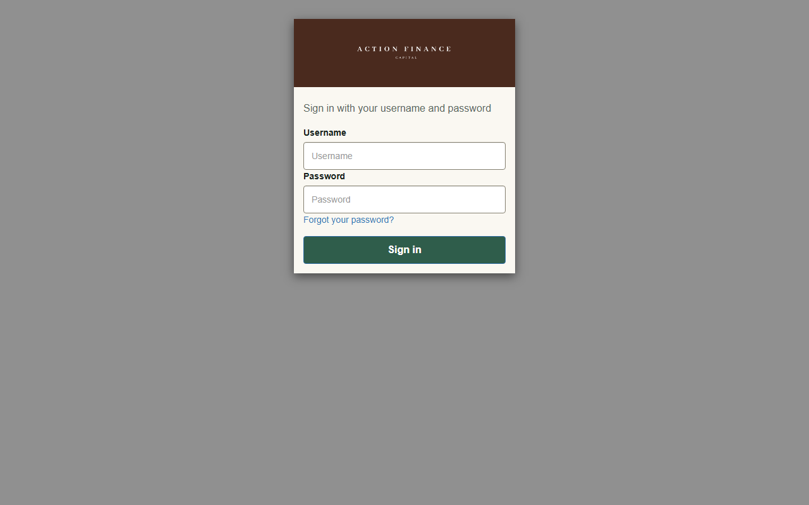

# ACTIONFINANCE_REV_LOGIN_COGNITO_063

10/11/2026. A tela pública de login do Finance passou para a identidade Loja/Gestão. Só o client confidencial do pool do Finance foi atualizado. Não houve deploy da aplicação. `make-logo.py` não rodou.

A cópia do prompt está em [ACTIONFINANCE_PROMPT_LOGIN_COGNITO_063.md](../prompts/ACTIONFINANCE_PROMPT_LOGIN_COGNITO_063.md).

## Patch

`git am -3` de `P02-login-cognito-identidade.patch` sobre `92ecd1ad`, sem conflito. O commit aplicado é `52e07e5bb66c0bafbf0d8c94bb4438b4b475def5`. Entra em `ops/aws/cognito-hosted-ui/`: CSS, logo e README.

## Apply

O dry-run confirmou o client do Finance e gravou `snapshot-atual.json` com o CSS azul que estava no ar. O pool do Finance não tem outro client. `.\apply-hosted-ui.ps1 -Apply` terminou sem erro.

`GetUICustomization` devolve o CSS novo: `#4a2a1e` e `#2f5d4b` presentes, `#1603ad` ausente. A versão do CSS é `20261110192051`.

Rollback: `.\rollback-hosted-ui.ps1` a partir do snapshot azul.

## Tela

A página pública de login abriu sem entrar, status 200, e permaneceu no formulário. A faixa mediu `rgb(74, 42, 30)`, o botão `rgb(47, 93, 75)` e o fundo do formulário `rgb(250, 248, 242)`. O logo é o letreiro branco sobre o marrom.

