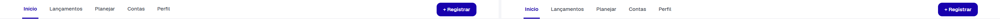
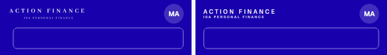
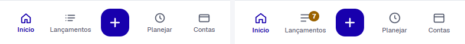
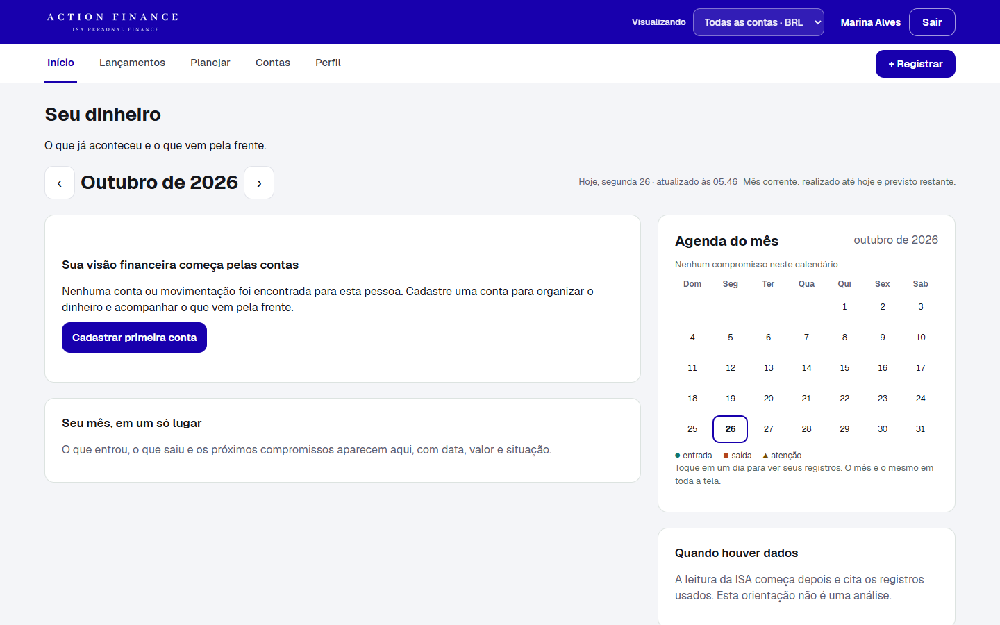
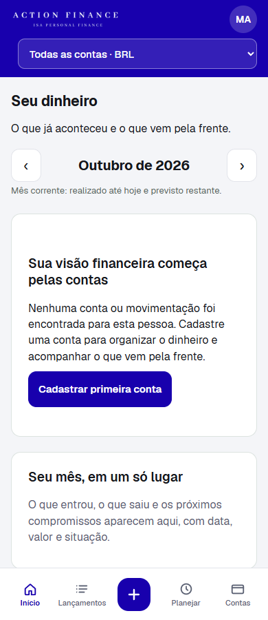
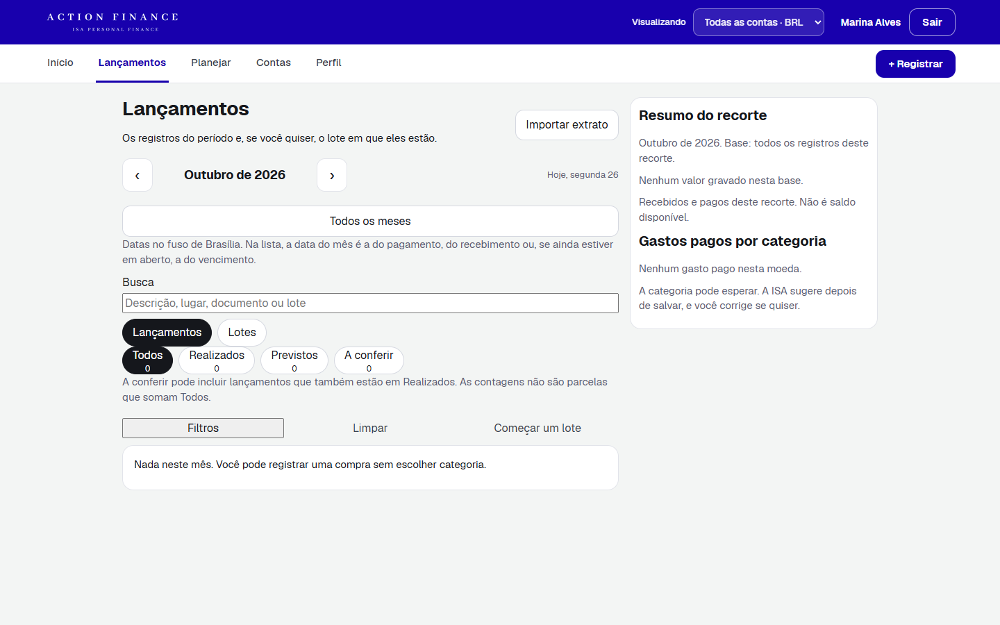
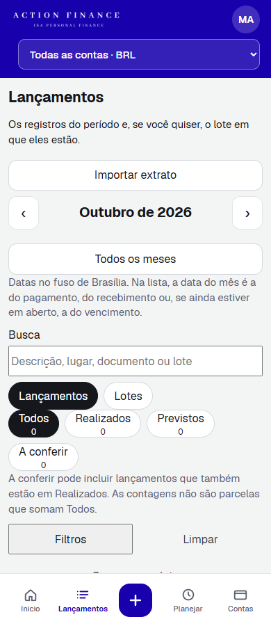
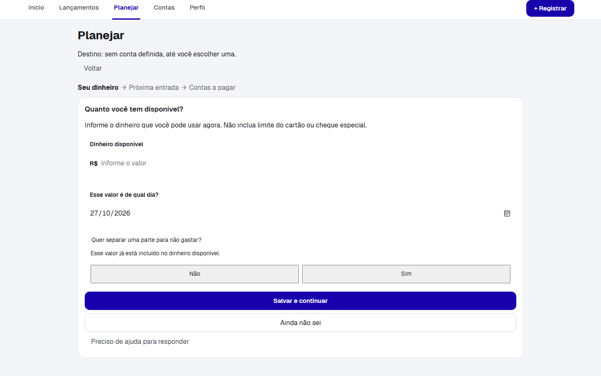
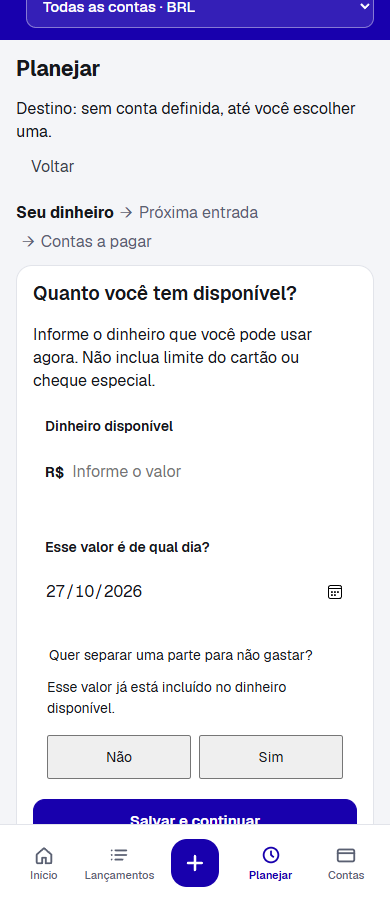

# ISA 006A-R1 — Correção da casca

Data da prova: 27/10/2026. Versão `isa-piloto 0.6.18`. Schema permanece 12. A base é a 0.6.17 (`e426947a`). Nada de regra financeira, número gravado ou ActionFinance mudou. O miolo das telas continua para o 006B.

As capturas estão em `documents/reviews/correcao-casca-006a-r1/`. Os dados da tela são do laboratório, com a pessoa Marina, não da conta publicada.

## Marca

Origem: `prototype/logoisantrans.png` (2000 × 2000, fundo `#1800AD`). O logotipo branco ocupa só a faixa central. Recorte, sem redesenho, feito em `C:\Projetos\isa`:

```
python -c "
from PIL import Image
src = Image.open(r'prototype/logoisantrans.png').convert('RGBA')
crop = src.crop((120, 840, 1800, 1115))
def save(height, path):
    width = round(crop.width * height / crop.height)
    image = crop.resize((width, height), Image.Resampling.LANCZOS)
    image.save(path)
save(32, r'prototype/marca-faixa.png')
save(64, r'prototype/marca-faixa@2x.png')
"
```

O recorte do Pillow é exclusivo na borda direita e inferior: `(120, 840, 1800, 1115)` produz 1680 × 275. O fundo permanece `#1800AD`. Saídas: `prototype/marca-faixa.png` 195 × 32 e `prototype/marca-faixa@2x.png` 391 × 64. A página usa `srcset` 1×/2×, altura 32 px no computador e 26 px no celular, `alt="Action Finance — ISA Personal Finance"`.

No computador a imagem mede 195 × 32 px e começa em x = 64, o mesmo x do bloco de texto da referência. Esse bloco, em `Inicio.html`, mede 190 × 26 px. 195 está 2,6% acima de 190, dentro de ±10%. A altura de 32 px é a pedida; o aspecto 1680/275 não deixa a largura chegar aos cerca de 250 px citados no pedido sem esticar o logotipo. A tinta branca medida em `Inicio-1440.png` (arquivo 2×, x 129–496) também fica perto de 184 px CSS, não de 250.

No celular a imagem mede 158 × 26 px. O bloco da referência em `MInicio.html` mede 149 × 21 px. 158 está 6,0% acima de 149.

## Cabeçalho

No computador a faixa roxa tem 64 px. A marca fica à esquerda. “Visualizando”, o seletor, o nome e “Sair” ficam à direita, com `margin-left: auto` no grupo. O seletor mostra “Todas as contas · BRL”.

No celular a primeira linha tem 56 px: marca à esquerda e círculo de iniciais à direita. O alvo de toque do círculo tem 44 px; o disco visível tem 40 px, como no desenho. A segunda linha é o seletor em largura total, 44 px, com 12 px abaixo. A faixa fecha em 112 px.

## Registrar e a data de hoje

Em Início, Lançamentos, Planejar, Contas, Perfil, Registrar, Importar, Conferir e Pendências, em 1440 e em 390, há um único controle visível. No computador é `#desk-registrar` na barra. No celular é `#nav-registrar`, o “+” do centro. O botão do topo do Início e o de Lançamentos saíram do HTML. “Registrar só este, fora do lote” e “Registrar a necessidade de atualização” continuam, porque são outras ações.

O laboratório usa uma data só. `ISA_REFERENCE_DATE` vale quando é um dia real; se não houver, o padrão é 2026-10-26. Produção ignora essa variável e usa o dia de São Paulo. O `runtime.js` do laboratório recebe `window.isaReferenceDate` com o mesmo valor que a API. Na prova, a faixa diz “Hoje, segunda 26” e o calendário marca o dia 26. No celular a faixa de “Hoje” não aparece, como no desenho; o calendário marca o dia 26. A cena sintética de outubro, nos testes HTTP, continua presa em 2026-10-16, que é a data do saldo daquela cena, não o padrão do laboratório.

## Recortes

Implementação à esquerda, referência à direita. O nome e o texto do seletor foram pintados com a cor da faixa antes da conta.


Faixa 1440: 4.957 pixels em 1.440 × 64, **5,38%**. Desses, 3.530 estão no retângulo da marca: o arquivo oficial, na altura pedida de 32 px, não coincide traço a traço com as duas linhas de CSS do desenho.



Barra de navegação 1440: 1.669 pixels em 1.440 × 56, **2,07%**.



Faixa 390, as duas linhas: 2.576 pixels em 390 × 112, **5,90%**. A maior parte é o mesmo recorte oficial contra o texto CSS.



Barra inferior 390: 1.837 pixels em 390 × 76, **6,20%**. Passa de 6%. A região é a coluna Lançamentos: 742 pixels, o selo “7” do desenho. Este recorte não coloca o selo; ele entra no 006C. Sem essa coluna, o restante é 1.095 pixels, 3,7% da barra, a suavização dos ícones. O mapa está em `barra-390-diff.png`.

## Telas

Início, Lançamentos e Planejar, em 1440 e 390:













Não houve rolagem horizontal em 360, 390, 768 nem 1440 nessas rotas.

## Testes

`python -m unittest discover -s server -p "test_*.py"`: 113 testes, ok, SQLite e PostgreSQL em `127.0.0.1:5442`.

`node prototype/ui.test.mjs` confere a ordem marca, iniciais, ferramentas, um único “+ Registrar”, um único `aria-label="Registrar"`, a ausência de `home-register` e `ledger-register`, e que o aplicativo não esconde o Registrar por rota. Também passaram `calc.test.mjs`, `lotes.test.mjs`, `bb-statement.test.mjs`, `recorte.test.mjs` e `regras-mes.test.mjs`.

## Publicação

Commit `9218efe2`, enviado sem force-push. Cópia antes da imagem: `backups/20261027T085151+0000/`, `verifiedUpload` true, 31 tabelas. Tarefa de cópia `6089e8436f7e416db740c88d5082e96b`, saída 0.

Imagem `sha256:c88927d1e966cadf485311e7d66f98f19072d47961a63fbaf09f4e9127a61256`. Tarefa `isa-web:27`. O serviço ficou em mínimo 100, máximo 200, rebalanceamento de zona ligado, uma tarefa em execução, rollout concluído. Retorno: `isa-web:26`, isa-piloto 0.6.17. O Financeiro não muda.

No ar, `https://isa.actionhub.com.br/api/health` responde `isa-piloto 0.6.18`, postgres, oidc. `/api/ready` responde schema 12. `/` e `/runtime.js` seguem `no-store`. O runtime publicado não traz data de referência; produção continua no dia real de São Paulo. `marca-faixa.png` e `marca-faixa@2x.png` respondem `public, max-age=31536000, immutable`. O HTML pede `fonts/fonts.css` no próprio domínio e não cita `fonts.bunny.net`.
