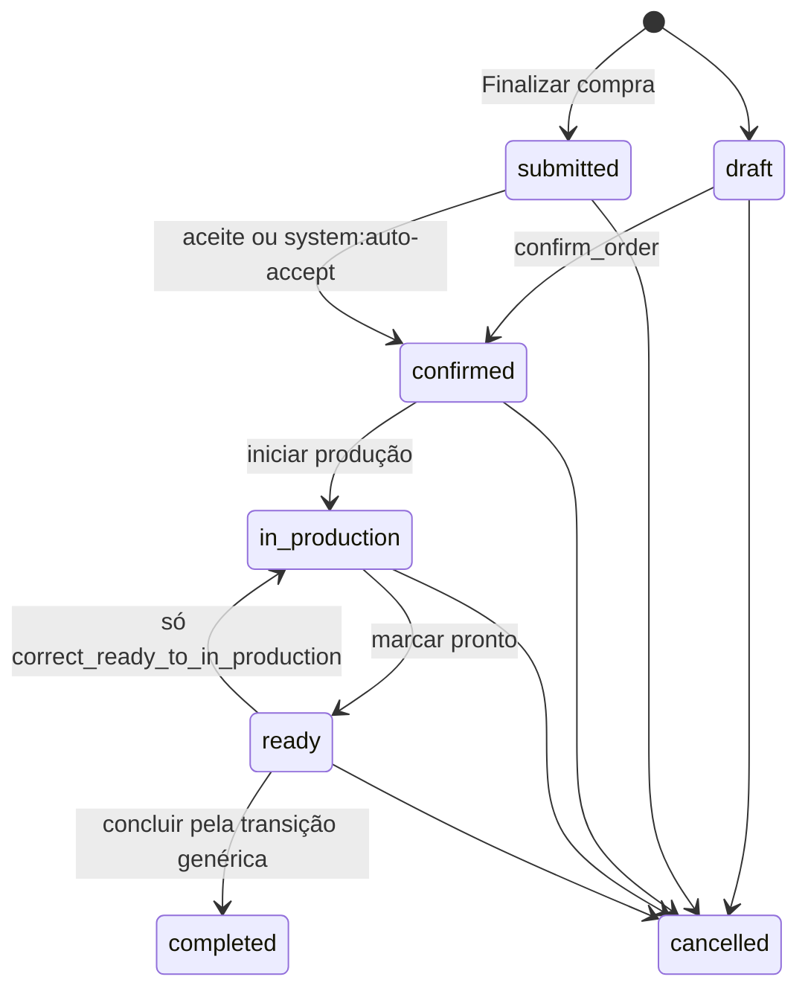
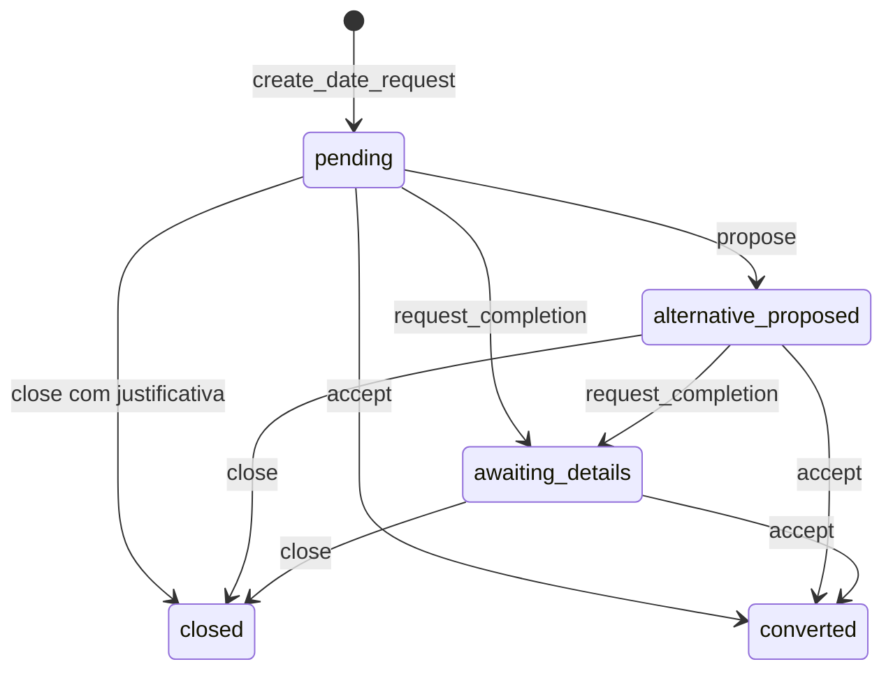

# Grafo de estados atual

Fonte: código em 29/10/2026. Três eixos coexistem. O operador vê um rótulo só.

## 1. Status persistido

`Order.status` em `backend/app/models/enums.py` (linhas 4–11): `draft`, `submitted`, `confirmed`, `in_production`, `ready`, `completed`, `cancelled`.

`ALLOWED_TRANSITIONS` (linhas 26–39):

Correção da hipótese do prompt: `in_production → completed` **não** está em `ALLOWED_TRANSITIONS`. Quem faz esse salto é `confirm_delivery` (`orders.py` 383+), que também grava `delivery_confirmed_at`. `transition_order(..., completed)` a partir de `in_production` levanta `TransitionError`. `ready → in_production` também não está na tabela; existe só em `correct_ready_to_in_production` (`orders.py` 418), chamada por script/teste, sem rota HTTP.

`CAPACITY_HOLDING_STATUSES` (linhas 17–24): `confirmed`, `in_production`, `ready`, `completed`. Cancelamento antes de `production_started_at` zera `holds_capacity`; depois, mantém (`orders.py` 269–270).

`draft` permanece na tabela e em `confirm_order`, mas `submit_order` não cria rascunho. Ver divergências.

## 2. Solicitação de data

`backend/app/models/date_requests.py` linhas 27–29: `pending`, `alternative_proposed`, `awaiting_details`, `converted`, `closed`.

`propose` grava `proposed_date` e **não** chama `occupy_capacity` (`date_requests.py` 196–217). Data proposta igual à desejada é recusada. `close` exige nota e e-mail com `@` (221–225).

## 3. Etapa visível

`visible_stage_for_order` (`order_board.py` 186–200) é função do status, do balde de `classify_payment` e de `delivery_confirmed_at`. A exclusão gerencial **não** entra nessa função: `managerial_board` (`order_board.py` 241–244) tira o id da fila e soma `excluded_tests`.

| Etapa | Quando |
|---|---|
| `cancelled` / Cancelado | status `cancelled` |
| `delivered` / Entregue | `completed` e `delivery_confirmed_at` preenchido |
| `finalized` / Finalizado | `completed` sem esse carimbo |
| `ready_legacy` / Pronto — aguardando confirmação de entrega | status `ready` |
| `in_production` / Em produção | status `in_production` |
| `paid` / Pago | `confirmed` e balde `paid` |
| `accepted` / Aceito | `confirmed` e qualquer outro balde |
| `open` / Aberto | resto, inclusive `submitted` e `draft` |

`rejected` / Rejeitado é etapa de solicitação `closed`, não de pedido (`order_board.py` 220–222).

## 4. Estado financeiro

Persistido em `PaymentRecord.financial_status` (`models/enums.py` `FinancialStatus`): `pending`, `paid`, `failed`, `cancelled`, `partially_refunded`, `refunded`, `unknown`.

Baldes de `classify_payment` (`order_board.py` 140–171): `unknown`, `refunded`, `partial_refund`, `no_amount`, `no_charge`, `cancelled_open`, `paid`, `processing` (pendente com `external_reference`), `awaiting` (pendente sem referência), `failed`, `charge_cancelled`.

`production_clearance` (174–179): `paid` e `no_amount` liberam; `unknown` é incerto; o resto é `unpaid`. Produção sem quitação só com `unpaid_exception=True`.

Webhook e reconciliação mudam o registro financeiro e, com isso, a etapa visível de `accepted` para `paid`. Não chamam `transition_order`.

## 5. Comandos

HTTP de domínio: `TransitionError`, `CapacityError`, `ConflictError` → 409; `UnpaidProductionError` → 409 com `financial_bucket`; `ConfirmationError` → 422; sem sessão → 401; CSRF ausente em POST → 403 (`main.py`, `deps.py`).

| Comando | Ator | Pré-condições | Antes → depois | Efeitos | Idempotência | Recusa |
|---|---|---|---|---|---|---|
| `submit_order` `POST /api/v1/orders` (`storefront_orders.py` 615, autoaceite 743–753) | cliente; `system:auto-accept` se produto padrão, data e sem adaptação pendente | cotação igual a `quoted_cents`; agenda comporta; endereço | novo → `confirmed` / Aceito, ou `submitted` / Aberto se houver adaptação | histórico no aceite; `holds_capacity` só no aceite (`occupy_capacity`); `order_accepted` + `order_auto_accepted_admin`, ou `order_submitted` + `order_submitted_admin`; CRM `pedido_enviar`; se `public_payments_enabled` e autoaceite, tenta `start_checkout` pix | mesma `idempotency_key` devolve o pedido | `PriceChangedError`, `CapacityError`, `ConfirmationError` |
| `confirm_order` via `POST /admin/orders/{id}/confirm` (`orders.py` 104; rota `admin/orders.py` 62–64 chama `transition_order` CONFIRMED, que delega) | admin | origem `draft` (exige data) ou `submitted` | `submitted`/`draft` → `confirmed`; etapa Aceito (Pago se já houver balde `paid`) | histórico `actor_ref`; ocupa capacidade; `order_accepted`; CRM `pedido_aceitar`; fidelidade `reconcile_order` | se já `confirmed` ou além, retorna sem nova linha de histórico | `TransitionError` 409; adaptação não bloqueia o domínio, a UI desabilita o botão (`OrderDetail.tsx` 318) |
| `start_production` `POST .../start-production` (`orders.py` 333; rota 80–92) | admin | origem `confirmed`; quitação `clear` ou `unpaid_exception` | `confirmed` → `in_production` / Em produção | histórico; motivo contém “sem quitação” na exceção; `production_started_at`; **nenhum** e-mail novo | já `in_production`: retorna | `UnpaidProductionError` 409; `TransitionError` |
| `transition_order` READY `POST .../mark-ready` (`orders.py` 304–309; rota 102–110, motivo `MARK_READY_REASON`) | admin | origem `in_production` | → `ready` / Pronto — aguardando… | `ready_at`; histórico; sem e-mail | já `ready`: retorna | `TransitionError` 409 |
| `transition_order` COMPLETED `POST .../complete` (rota 114–122, motivo “entregue ou retirado”) | admin | origem `ready` | → `completed` / **Finalizado**; `delivery_confirmed_at` continua nulo | `completed_at`, `fulfilled_at`; fidelidade; sem e-mail | já `completed`: retorna | `TransitionError` se a origem for `in_production` |
| `confirm_delivery` `POST .../confirm-delivery` (`orders.py` 383) | admin | origem `in_production` ou `ready` | → `completed` / **Entregue** | carimba `delivery_confirmed_at`; histórico; sem e-mail | segunda chamada não duplica histórico | `TransitionError` |
| `correct_ready_to_in_production` (`orders.py` 418) | script `assisted` | origem `ready` | `ready` → `in_production` | histórico `READY_REPAIR_REASON`; sem e-mail; sem rota | segunda chamada `TransitionError` | `TransitionError` |
| `cancel_order` `POST .../cancel` (`orders.py` 245; rota 126–136) | admin | motivo não vazio; origem com transição para `cancelled`; não `completed` | → `cancelled` / Cancelado | histórico; `holds_capacity` false se produção não começou; fidelidade; sem e-mail | já cancelado: retorna, ignora o segundo motivo | `ConfirmationError` 422 sem motivo; `TransitionError` 409 se concluído |
| `add_internal_note` `POST .../notes` (`orders.py` 438; rota 159–166) | admin | texto | status e etapa intactos | linha de nota | cada POST grava outra nota | validação 422 se vazio |
| `propose_production_date` `POST .../propose-date` (`storefront_orders.py` 1344) | admin | pedido ainda proponível | status intacto; data pedida muda | sem reserva nova por si; sem kind próprio além do que o aceite posterior gerar | — | `ConfirmationError` |
| `accept_proposed_date` (vitrine, `storefront_orders.py` 1354) | cliente | proposta vigente | pode confirmar a data | aviso de aceite se o domínio confirmar | — | `ConfirmationError` |
| `evaluate_adaptation` `POST .../items/{id}/adaptation` (`adaptations.py`) | admin | item com adaptação; pedido `submitted` na UI (`OrderDetail.tsx` 498) | status não muda por si | `adaptation_proposed` ao propor alternativa | — | `ConfirmationError` |
| `apply_date_request_action` propose `POST /admin/date-requests/{id}` | admin | não encerrada; data diferente e não passada | `pending` → `alternative_proposed` | `date_request_proposed`; sem reserva | — | `ConfirmationError` 422 |
| `request_completion` | admin | e-mail válido | → `awaiting_details` | `date_request_complete` | — | `ConfirmationError` |
| `close` | admin | justificativa e e-mail | → `closed` / Rejeitado na fila | `date_request_declined` | já closed: `ConfirmationError` | 422 sem nota |
| `accept_date_request` | admin | linhas cotáveis | → `converted` e pedido `confirmed` | `confirm_order` + `notify_acceptance` (`acceptance_update_admin`; push kind `acceptance_update`) | aceite de já convertida devolve a mesma | `ConfirmationError` / `ConflictError` |
| `exclude_subject` / `reverse_subject` (`managerial_exclusion.py` 63 e 85) | sem rota HTTP; `classify_tests` é domínio | — | status e etapa **iguais**; some da fila | `excluded_tests` sobe; avisos futuros podem ser suprimidos | segunda exclusão devolve a linha ativa | — |
| `start_checkout` (vitrine; `storefront_orders.py` 1056) | cliente | status aceito (`confirmed`/`in_production`/`ready`/`completed`); não quitado | status intacto | cria/reusa `PaymentRecord`; Hub via `recover_or_create_checkout` | mesma referência e método: `reused` | `ConfirmationError` “depois do aceite” se `submitted` |
| `start_checkout(..., replace=True)` | cliente | cobrança pendente com referência | status intacto | cancela a tentativa anterior (`financial_status=cancelled`) e abre outra | — | `ConfirmationError` se o Hub disser que a anterior já foi paga |
| `apply_actionhub_observation` (`payment_webhooks.py` 88) | worker / webhook | `app_id`, `outbox_id`, valor pago inteiro igual ao esperado | status operacional intacto; etapa pode ir a Pago | `payment_approved` na primeira quitação; CRM `pagamento_registrar`; fidelidade | mesmo `outbox_id`: `duplicate: true`, sem segundo e-mail; se já pago, preenche `mp_payment_id` vazio sem repetir efeitos | `AuthError`; valor divergente → evento `ignored` |

## 6. Onde a etapa é recalculada fora de `order_board.py`

A função mora em `order_board.py`. Estes pontos a chamam de novo ou desenham outro rótulo. Alvo do Prompt 108:

| Arquivo | Linha | O que faz |
|---|---|---|
| `backend/app/domain/admin_orders.py` | 474–475 | lista e detalhe chamam `visible_stage_for_order` / `visible_label_for_order` |
| `backend/app/domain/attendance.py` | 139–140 e 171–172 | resumo e itens da fila |
| `backend/app/domain/production_agenda.py` | 54 | agenda usa o rótulo visível |
| `backend/app/domain/order_board.py` | 308–314 | o próprio quadro, dentro de `managerial_board` |
| `frontend/src/admin/OrdersList.tsx` | 19–33 | se não houver `visible_label`, cai em `statusLabel` ou no texto “Encomenda: Aguardando avaliação de A Loja” |
| `frontend/src/admin/format.ts` | 4–16 | rótulos do **status persistido**, não da etapa (`submitted` = “Solicitado”, `completed` = “Finalizado”) |
| `frontend/src/admin/admin.css` | 90–97 | cor por classe `is-*` |
| `frontend/src/admin/OrderDetail.tsx` | 235 | classe `admin-stage is-${visible_stage}` |
| `frontend/src/admin/AttendanceSummary.tsx` | classes `is-in-production` etc. | pinta a lente com a classe, o texto vem da API |
| `frontend/src/shop/OrderStatusPage.tsx` | 63, 257–262 | rótulos próprios da vitrine, paralelos ao painel |
| e-mail `email_outbox.py` | templates 15–114 | não calculam etapa; falam “aceite ainda não significa pago, em produção ou entregue” |
