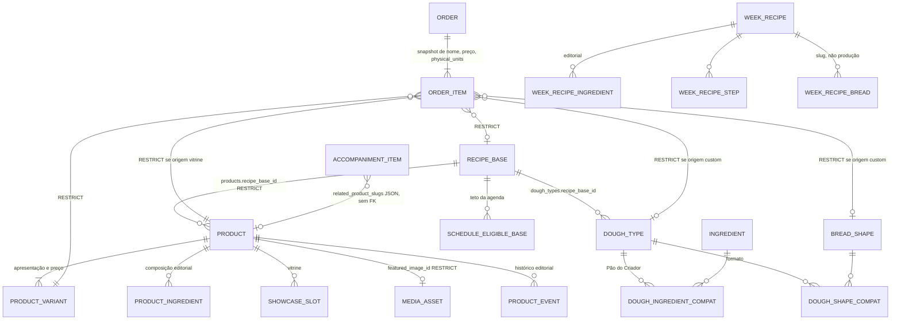

# Inventário de catálogo

“Receita” e “produto” nomeiam coisas diferentes. Nada aqui redesenha o modelo.

## Produto padrão da vitrine

Tabelas: `products`, `product_variants`, `product_ingredients`, `product_events`, `media_assets`, `showcase_slots` (`models/products.py`).

Estados do produto: `editorial_status` `draft` | `published` | `archived` (linha 56); `is_available`; `fidelity_eligible` default true (linha 79). Variante: `is_active`, `presentation_type`, `price_cents`, `physical_units`, `net_weight_grams`.

Tela: `/admin/produtos` `ProductsList.tsx`; editor `/admin/produtos/novo` e `/admin/produtos/:id` `ProductEditor.tsx`. Aba “Vitrine e cadastro” em `CatalogTabs.tsx` 6–12. API: `GET/POST /api/v1/admin/products`, detalhe e publicação no mesmo router.

Quem consome: vitrine pública, cotação `quote_lines`, agenda pela `recipe_base_id`, fidelidade pelo flag `fidelity_eligible`.

No pedido (`storefront_orders.py` 690–698): copia `physical_units`, `quantity`, preço unitário e total da linha, peso, e grava o nome do produto em `dough_name_snapshot` e a apresentação em `shape_name_snapshot`. Mantém FK `product_id`, `product_variant_id`, `recipe_base_id` com `ON DELETE RESTRICT` (`orders.py` 185–193).

`GET /api/v1/admin/products` chama `fill_empty_showcase_slots` (`admin/products.py` 63) e a sessão da request dá commit (`db/session.py`). Efeito colateral de leitura, F02 do 106.

## Pão do Criador

`dough_types`, `ingredients`, `bread_shapes`, `dough_ingredient_compatibilities`, `dough_shape_compatibilities`, `pairing_tips`, `allergens`, `dough_allergens`, `ingredient_allergens` (`models/catalog.py`). Estados: `is_active` em massa, ingrediente e formato.

Não há aba “Criador” no `CatalogTabs`. O pão sob encomenda usa essas tabelas por `domain/custom_loaf.py` e `CustomLoafPanel.tsx`.

No pedido de origem `custom` (`storefront_orders.py` 672–684): FK `dough_type_id`, `bread_shape_id`, `recipe_base_id` RESTRICT; `product_variant_id` fica nulo (check `ck_order_items_origin`, `orders.py` 165–172). Nome da massa vai para `dough_name_snapshot`; formato para `shape_name_snapshot`.

## Receita-base de produção

`recipe_bases` (`models/schedule.py` 26) e `schedule_eligible_bases` (127). Teto: `ScheduleSettings.daily_base_limit` (61). A agenda (`SchedulePage.tsx`) escolhe quais bases entram no dia. A vitrine aponta o produto para uma base (`products.recipe_base_id`).

Quem consome: capacidade em `domain/schedule.py` (“não comporta um tipo de pão novo”). Não é a receita culinária da semana.

## Pão sob encomenda

`domain/custom_loaf.py` e painel `CustomLoafPanel.tsx`. Preço e peso próprios (o teste `OrdersScope.test.tsx` lê `price_cents` e `weight_grams`). Não cria linha em `products`. Vira item de pedido na origem `custom`.

## Receita culinária da semana

`week_recipes`, `week_recipe_ingredients`, `week_recipe_steps`, `week_recipe_breads` (`models/week_recipes.py`). Editorial. Telas `/admin/produtos/receitas` e `/admin/produtos/receitas/nova|:id`. API `/api/v1/admin/week-recipes`. Não ocupa forno e não entra em `order_items`.

## Gigio e harmonizações

`gigio_editorial_notes` e `gigio_pairing_references` (`models/gigio.py`). Telas `/admin/produtos/gigio` (`GigioNotes.tsx`) e `/admin/produtos/gigio/harmonizacoes` (`PairingRefs.tsx`). Conteúdo de conversa, não de produção. `pairing_tips` do catálogo é outra tabela.

## Acompanhamentos

`accompaniment_items` (`models/accompaniments.py`). `hub_source` default `mercadolivre` (32). Snapshot de título, preço e link da oferta do Hub. `related_product_slugs` é JSON, sem FK. Tela `/admin/produtos/complementos` (`AccompanimentsAdmin.tsx`). Não é tarefa de produtor parceiro nem componente de kit.

## Fidelidade

`house_fidelity_*` (`models/house_fidelity.py`). Elegibilidade do produto: coluna `products.fidelity_eligible`. O pedido guarda `fidelity_qualifies` e `fidelity_opt_in` (`storefront_orders.py` 666 e 732). Reconciliação em `house_fidelity_ledger.reconcile_order`, chamada no aceite, no cancelamento, na conclusão e na quitação. Tela `/admin/fidelidade` (`FidelityParticipants.tsx`).
