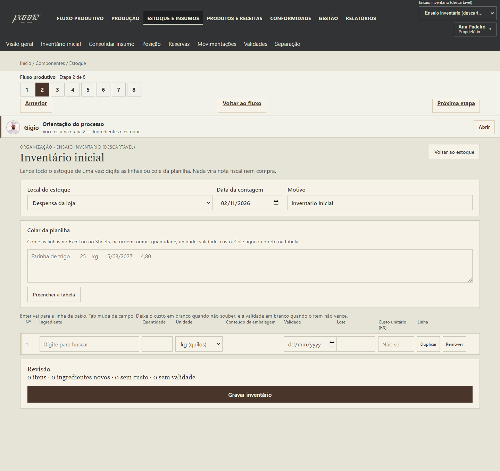
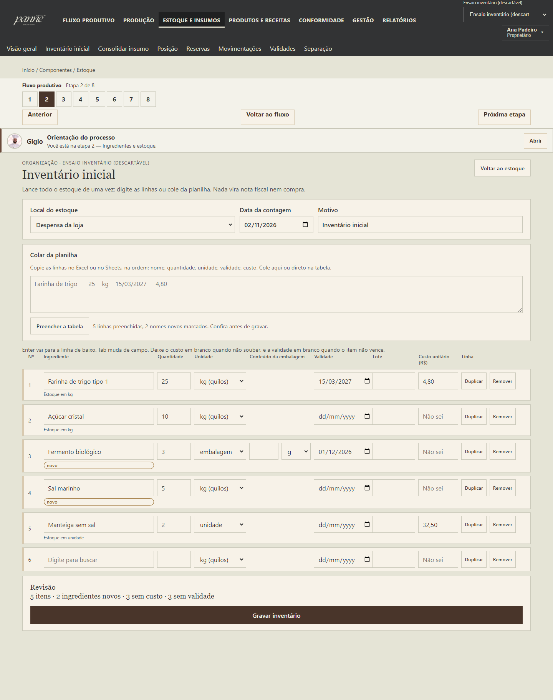
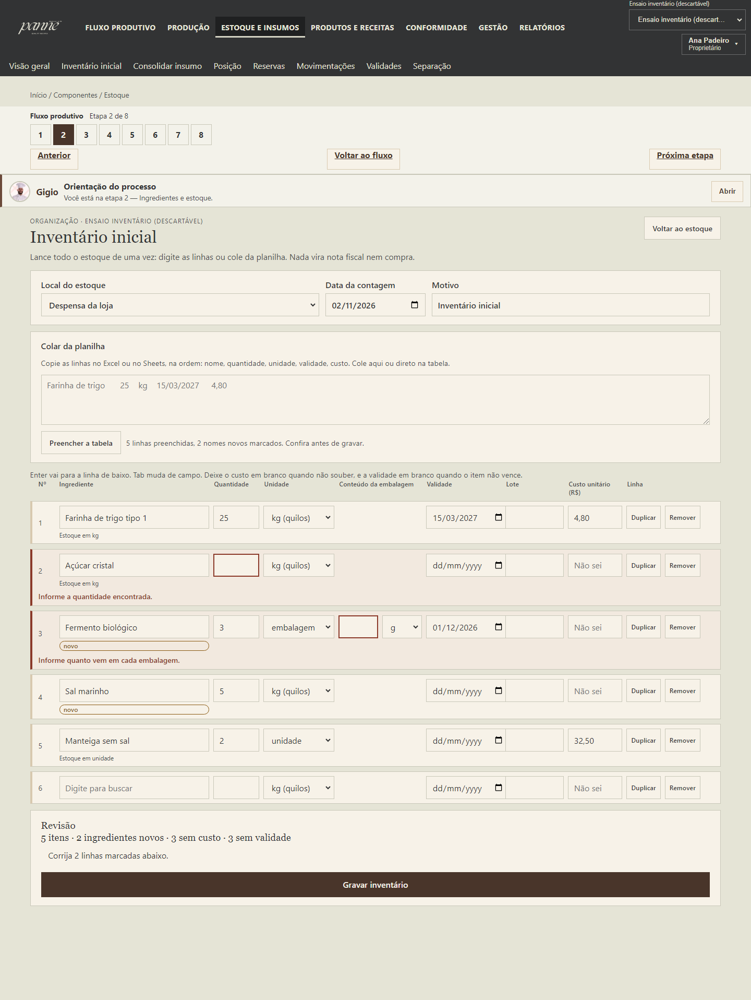
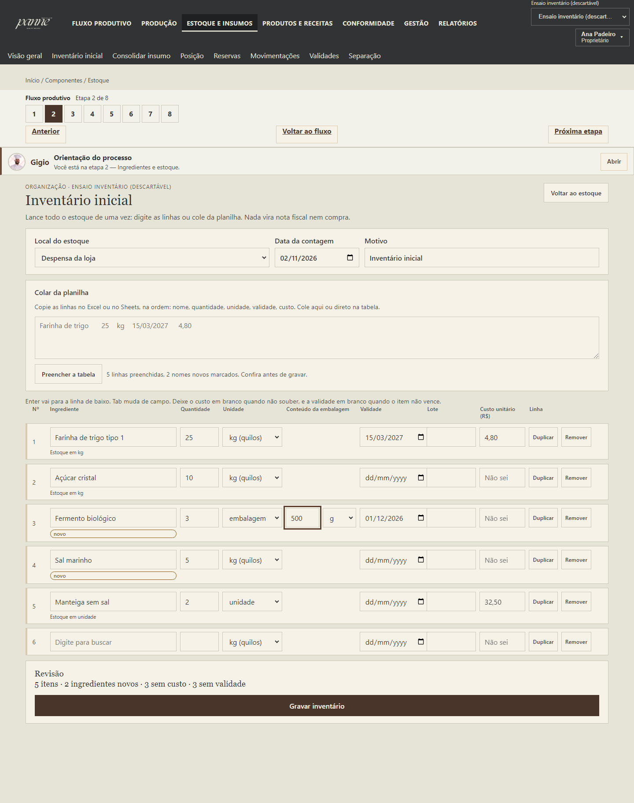
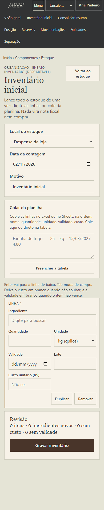
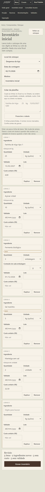
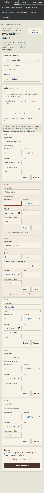
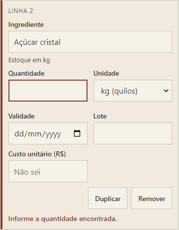
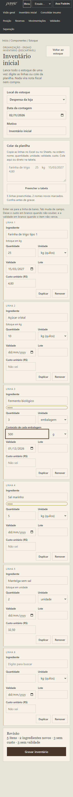

# CURSOR-031 — Retorno: inventário inicial em lote

Data: 02/11/2026. Worktree `C:\Projetos\_panne-031`, branch `feat/panne-031-inventario-lote`, criada a partir da tag `panne-prod-2026-09-25` (`85d9dfb7`).
Código em produção: commit `d8d22fe9`, tag `panne-prod-2026-11-02`. Este arquivo e as capturas vão num segundo commit só de documentação.

**Não lancei dados na Loja.** As gravações de teste foram em organizações descartáveis num Postgres local descartável. A 0030 e a 0031 já tinham lote, validade e conteúdo da embalagem, então **não há migração**.

## O que mudou para quem usa

- Menu de Estoque: "Abrir saldo sem nota" virou **"Inventário inicial"** (`/componentes/estoque/inventario`). A tela antiga segue em `/componentes/estoque/abertura`. O link discreto da Visão geral agora diz "Lançar inventário inicial".
- Uma tabela para o estoque inteiro: ingrediente (com busca e "Criar '<nome>'"), quantidade, unidade, conteúdo da embalagem (só aparece quando a unidade é embalagem), validade, lote e custo (vazio = "Não sei").
- Colar da planilha (nome, quantidade, unidade, validade, custo), rascunho no navegador, revisão com resumo e um botão "Gravar inventário". Erro aparece na linha e nada digitado se perde.
- Em 390 px cada linha vira um cartão, com alvos de toque de 44 px (medido: menor campo/botão = 44 px).

## 1. API — `POST /inventory/openings/batch`

- Cabeçalho: `inventory_location_id`, `counted_on` (padrão hoje; futuro é recusado), `reason` (padrão "Inventário inicial"). Até 200 linhas.
- Linha: `ingredient_id` **ou** `new_ingredient {display_name, unit_code}`; `quantity` + `unit_code`; `package_content_quantity/unit` (obrigatório quando a unidade é embalagem); `lot_code`; `expires_on` **ou** `no_expiry`; `unit_cost` **ou** `cost_unknown`.
- **Atômico:** todas as linhas rodam dentro de uma transação; se qualquer uma falhar nada é gravado (inclusive ingrediente novo). A resposta é HTTP 422 com `errors: [{index, field, code, message}]`, mensagens em português.
- **Idempotente** pela chave do lote (`Idempotency-Key`): repetir o mesmo corpo devolve `replayed: true` sem gravar de novo; outro corpo com a mesma chave dá 409.
- **Sem duplicar regra:** cada linha chama `services.open_balance` (mesma permissão `inventory.adjust`, mesmas regras de custo/origem/unidade) e o cadastro de ingrediente sem nota (`create_ingredient`, código sugerido). Dois ajustes pequenos no serviço existente, que também valem para a tela antiga: ele passou a aceitar o conteúdo da embalagem (grava no lote via `apply_package_content`) e a respeitar a data da contagem.
- Limite honesto: o estoque só controla massa e unidade. Linha em ml/l é recusada com mensagem clara; embalagem pode trazer conteúdo em g, kg, ml ou l.

## 3. G14 — `migrate_once.py`

`run_upgrade()` faz o upgrade e restaura `FORCE ROW LEVEL SECURITY` num `finally` (com `rollback` antes se o upgrade falhar). Teste com falha simulada no upgrade, com conexão falsa (ordem dos eventos) e com banco real (a proteção volta).

## Arquivos alterados (vs. tag `panne-prod-2026-09-25`, 25 arquivos, +3657 −15)

Backend
- `backend/app/modules/inventory_procurement/opening_batch.py` (novo)
- `backend/app/modules/inventory_http/router.py` (rota)
- `backend/app/modules/inventory_procurement/services.py` (conteúdo da embalagem, data da contagem)
- `backend/app/modules/production_http/errors.py` (mensagens humanas)
- `backend/migrate_once.py`, `backend/pyproject.toml` (E501 só nos dois testes novos)
- `backend/tests/test_inventory_opening_batch.py`, `backend/tests/test_migrate_once_force_rls.py` (novos)

Frontend
- `frontend/src/pages/InventoryBatchPage.tsx`, `frontend/src/pages/inventoryBatch.ts` (novos)
- `frontend/src/App.tsx`, `components/Shell.tsx`, `fluxo/formRoutes.ts`, `pages/InventoryPages.tsx`
- `frontend/src/api/client.ts`, `api/errors.ts` (erros por linha), `api/types.ts`
- `frontend/src/styles/app.css` (só acréscimo, bloco `.inv-*`)
- `frontend/src/test/fetchMock.ts`
- `frontend/src/pages/FiscalDocumentPage.tsx`, `pages/ReceiptSheet.tsx` — **dois erros de tipo que já existiam na tag** e quebravam `npm run build` (`tsc --noEmit`). Correção mínima, sem mudar comportamento.
- Testes novos: `frontend/src/inventory-batch-031.test.tsx`, `frontend/src/pages/inventoryBatch.test.ts`

Apoio
- `frontend/scripts/capture-inventario-lote-031.mjs`, `scripts/dev/seed-inventario-lote-031.py` (captura em organização descartável)

Os scripts de sync de banco (`sync-db-from-lan.ps1`, `infra/*sync*`, `infra/open-leaction-db-lan.ps1`) não foram alterados.

## Testes da área e resultado

Só a área. Nenhuma suíte completa.

| Escopo | Arquivos | Resultado |
|---|---|---|
| API do lote, G14, abertura de saldo, ingrediente rápido | `test_inventory_opening_batch.py` (9), `test_migrate_once_force_rls.py` (3), `test_inventory_procurement.py`, `test_ingredient_link_consolidate.py`, `test_ingredient_suggested_code.py` | **37 passed** (Postgres descartável em Docker, não o banco `panne` local) |
| Tela e lógica | `inventory-batch-031.test.tsx` (14), `inventoryBatch.test.ts` (18) | **32 passed** |
| Vizinhos que a mudança poderia afetar | `insumo-manual-uso`, `estoque-visao`, `ingredients-r026-008`, `fiscal-028d` | **passed** (88 testes ao todo com os dois acima) |
| `tsc --noEmit`, `npm run build` | — | ok |
| eslint nos arquivos tocados | — | limpo |

O que a tela nova cobre nos testes: abre vazia com local/data/motivo uma vez só; menu sem "Abrir saldo sem nota" e tela antiga ainda abre; colar 5 linhas (marca "novo", resumo "5 itens · 3 ingredientes novos · 3 sem custo · 3 sem validade"); colar direto na tabela; Enter e linha automática no fim; escolher e "Criar"; duplicar e remover; rascunho sobrevive a recarregar; erro de linha (do cliente e do servidor) sem perder o digitado; gravar e link para a Visão geral; sem termos técnicos; 390 px.

**Falhas que já existiam e não são deste trabalho.** Rodei os mesmos arquivos na tag, com minhas mudanças guardadas (stash), e deu o mesmo: 7 testes falhando em `assistant.test.tsx` (2), `human-language-r026-004b.test.tsx` (1), `inventory.test.tsx` (1), `surface-language.test.ts` (1, "append-only" em `InventoryPages.tsx`) e `insumo-manual-mobile-390.test.tsx` (2, esperam o botão do Gigio numa rota de formulário). Não mexi. O teste do assistente conta uma rota sem guia a mais (12 em vez de 11): é a rota nova, igual à `/abertura`, que também não tem guia.

## Capturas (1440 e 390 px)

Organização descartável com a API real. A de 1440 também gravou de verdade (5 itens) e abriu a Visão geral depois.

### 1440 px

| Vazia | 5 linhas coladas |
|---|---|
|  |  |

| Erro numa linha | Revisão |
|---|---|
|  |  |

Depois de gravar e Visão geral do estoque: [gravado](../evidencias/cursor-031/capturas/1440-5-gravado.png), [visão geral](../evidencias/cursor-031/capturas/1440-6-visao-geral-depois.png). O Fermento (embalagem de 500 g) entrou sem o aviso de "conteúdo ainda não confirmado"; Manteiga e Leite, abertos pelo caminho antigo sem conteúdo, continuam com o aviso.

### 390 px

| Vazia | 5 linhas coladas |
|---|---|
|  |  |

| Erro numa linha | Detalhe do cartão com erro | Revisão |
|---|---|---|
|  |  |  |

Medidas (em `capturas-1440.json` e `capturas-390.json`): sem estouro horizontal nos dois tamanhos; menor campo ou botão de linha = 44 px.

## 4. Deploy — prova

Conta `253137917703`, `us-east-2`. Nada de banco, secret ou migração.

1. **Commit e push:** `d8d22fe9` em `feat/panne-031-inventario-lote` (sem force).
2. **Imagem:** `panne/backend` com as tags `d8d22fe9` e `prod-d8d22fe9`, digest `sha256:e529e28b6f8ad4a5782b8bd496455f3a7ca8247d8b906232d3686b5b0c1d074b` (linux/amd64, empurrada 14:45 BRT). A lifecycle do repositório protege `prod-*`.
3. **Task definition `panne-prod-api:22`**, a partir da `:21`. Comparei as duas, campo a campo, antes de registrar: a única diferença é a imagem (`@sha256:76d476bc…` → `@sha256:e529e28b…`). Serviço `panne-prod-api` atualizado para `:22`; rollout `COMPLETED`, 1 tarefa rodando, a `:21` saiu. `panne-demo-api` não foi tocado.
4. **Frontend:** build de produção com a mesma configuração pública que o bundle anterior (conferida no próprio bundle: API `https://api.panne.ia.br`, Cognito, `https://panne.ia.br/callback`). Subi `assets/index-bhQpKyXa.js`, `assets/index-B0Q5EVYX.css` e `index.html` (sem cache) no bucket `panne-prod-frontend-253137917703`, e invalidei `/` e `/index.html` na distribuição `E1QFFOL2JO2RBJ` (`panne.ia.br`). Nada foi apagado do bucket.
5. **Verificação:**
   - `https://api.panne.ia.br/health` → 200 (`ambiente: production`); `https://api.panne.ia.br/ready` → 200.
   - `POST …/inventory/openings/batch` sem token → 401 (a rota existe em produção).
   - `https://panne.ia.br/componentes/estoque/inventario` → 200 e serve `index-bhQpKyXa.js` (o bundle novo), sem erro de JavaScript; sem sessão ele vai para a tela de entrada ([captura](../evidencias/cursor-031/capturas/prod-rota-inventario-sem-login.png)).
   - **Não abri a tela logado em produção**: não tenho credencial. A tela foi exercida de ponta a ponta no ambiente local com a API real (acima). Quem entrar com a conta da Loja confirma o último passo.
6. **Tag git:** `panne-prod-2026-11-02` (anotada, aponta para `d8d22fe9`), empurrada.

## Rollback

API e frontend voltam juntos. A tela nova chama uma rota que a `:21` não tem, então só o frontend novo com a API antiga quebraria o "Gravar inventário".

```
aws ecs update-service --cluster paneldx-cluster --service panne-prod-api --task-definition panne-prod-api:21 --region us-east-2
```

A `:21` usa `panne/backend` com o digest `sha256:76d476bc…` (filho do índice `prod-85d9dfb7`, protegido na lifecycle).

Frontend: os arquivos antigos continuam no bucket (`assets/index-SsQR5RIV.js` e `assets/index-Ch14eznC.css`, conferidos). Basta devolver o `index.html` anterior, guardado em `documentacao/evidencias/cursor-031/index.html.anterior-prod`, e invalidar:

```
aws s3 cp documentacao/evidencias/cursor-031/index.html.anterior-prod s3://panne-prod-frontend-253137917703/index.html --content-type text/html --cache-control "no-cache, no-store, must-revalidate"
aws cloudfront create-invalidation --distribution-id E1QFFOL2JO2RBJ --paths "/index.html" "/"
```

## O que ficou para trás

- Container Docker `panne031_testdb` (porta 55432) segue de pé; é só de teste e pode ser removido.
- Para fechar o ciclo na Loja: entrar em `panne.ia.br` com a conta da Loja, abrir "Inventário inicial", colar uma amostra e conferir a revisão (sem gravar, ou gravando só quando for o lançamento real).
